# Great Bespoke CYD

**A resident Console, a multi-provider AI usage dashboard, browser SD file transfer and a readable SSH terminal for the original ESP32 Cheap Yellow Display.**

[Project website](https://staffordlumsden.github.io/great-bespoke-cyd/) ·
[Download firmware](https://github.com/staffordlumsden/great-bespoke-cyd/releases/latest) ·
[Install safely](docs/install.md) · [Build a new app](spec/SPEC.md)

## New release: Usage 0.2.0

**Ollama + Codex, with room for more.** The renamed Usage app adds a source
selector, Codex's five-hour/weekly allowances, optional OpenRouter key spending
and authenticated custom JSON feeds. Same PixelFonts and both themes.

[**Download Usage 0.2.0 — early access**](https://github.com/staffordlumsden/great-bespoke-cyd/releases/tag/usage-v0.2.0) ·
[Setup, existing Codex login and providers](projects/usage/README.md) ·
[See the dashboard](https://staffordlumsden.github.io/great-bespoke-cyd/#usage)

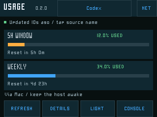
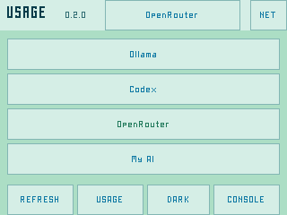

The Mac bridge reuses the signed-in Codex CLI and keeps OAuth on the host.
The CYD receives read-only usage over verified HTTPS. No OpenAI Platform key
is required. OpenRouter needs its own key only if you choose to add it.

Pinned builds, automated tests and live host Ollama/Codex/parser checks pass.
**Basic CYD check passed:** SD installation, Codex meters and switching back to
Ollama are user-confirmed. Extended runtime checks remain pending. The download contains no real keys or
bridge certificates. An SD reader provisions the separate private configuration.

---

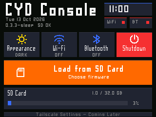
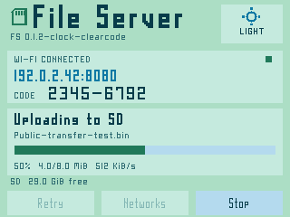

One inexpensive screen can do several useful jobs without one giant firmware.
Console lives in the factory partition. Separate apps are selected from an SD
library, checked and installed into flash, then return to Console when finished.
PixelFonts, flat controls, dark teal and mint/blue themes give the tools a shared
visual language. Large touch targets and adjustable terminal lettering matter
more than squeezing another row of tiny controls onto a 320×240 panel.

## What is included

| Firmware | Purpose | Version / status |
|---|---|---|
| [CYD Console](projects/launcher/README.md) | Resident SD firmware launcher, clock, themes, sleep/touch wake | **0.3.3-sleep** |
| [File Server](projects/file-server/README.md) | Browser upload/download over 2.4 GHz Wi-Fi, progress/cancel, network setup | **0.1.2-clock** |
| [Terminal Micro](projects/terminal-micro/README.md) | BLE keyboard + pinned-host SSH + bounded ANSI terminal | **0.2.3-headroom** |

| [Usage](projects/usage/README.md) | Ollama/Codex allowances, OpenRouter key budgets and custom feeds | **0.2.0 · early access** |

This public edition contains these four tools and their shared dependencies.
Other private apps are excluded. Console is custom ESP-IDF firmware; it is not
a fork or port of M5Launcher.

## Screenshots and evidence

All device pictures here are **captures from the actual firmware renderers
using public test fixtures**, not hardware photographs or live private sessions.
Browser pictures show the actual File Server HTML and fonts against a local
mock API. They explain the layout without exposing network names, credentials,
host fingerprints or private terminal output. They do not substitute for hardware
acceptance. The website's decorative yellow device frame is CSS.

Console, File Server and Terminal Micro preserve the builds accepted on the original tested CYD. Usage is a separately labelled early-access candidate.
Source layout has been made portable and shared terminal code extracted to
`common/`. A source rebuild is a **candidate**, not a bit-identical or newly
hardware-accepted image. See [release evidence and limits](docs/status.md) and
[public-layout validation](validation.json).

## 1. Console: choose an app and return home

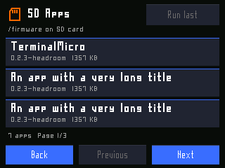
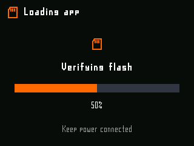

Console keeps the home screen focused on the device. It provides a whole-screen
light/dark switch, clock settings, SD capacity, a firmware picker, install
progress and **Run last**. Each app has a visible **Console** return.

1. Put matching app `.bin`, `.json` and `-LICENSE.txt` files under `/firmware`
   on your FAT32 microSD.
2. Choose **Load from SD Card → app → Install + run**.
3. Return from the app with **Console**, or use **Run last** to reopen it.
4. **Shutdown** unmounts SD, sleeps the display/backlight and enters ESP32 deep
   sleep. Tap to wake. It does not cut USB power; a power LED may remain on.

For touch-at-boot recovery, hold the screen while connecting power for at least
five seconds, then release. Factory Console starts without erasing bonds or SD
files. Keep the clock-capable File Server build in one OTA slot; other apps rotate
through the remaining slot. Install File Server first on a fresh library.

**Current limits:** Console Wi-Fi and Bluetooth tiles are placeholders. Tailscale
is unimplemented. Original ESP32 UART USB connectors cannot expose the card as a
native USB disk. Exact sleep current has not been measured.

## 2. File Server: leave the card in the CYD

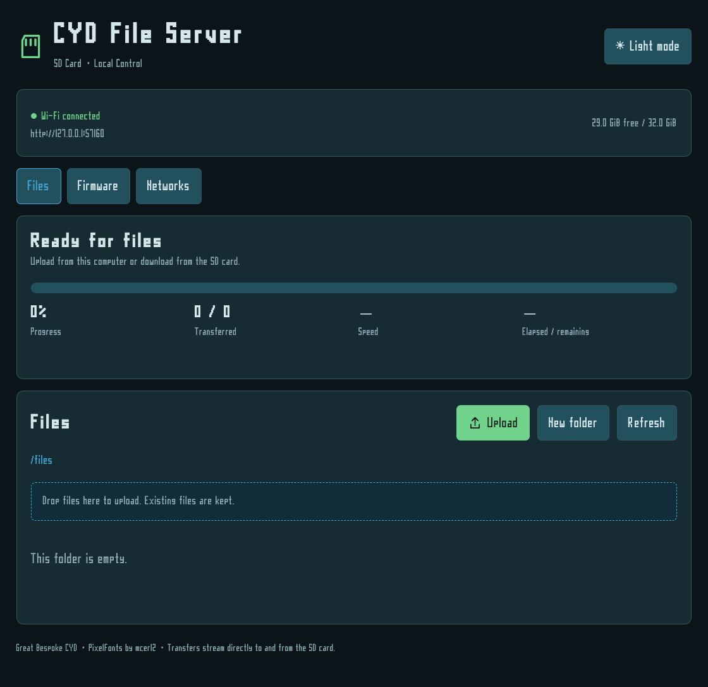

The CYD displays its IP address, port and a large eight-digit access code.
Open that address in a browser on the same LAN and enter the code. The code
changes on boot and uses a restricted digit set to avoid ambiguous characters.

- Upload multiple files through the browser queue; download files or create folders.
- Transfer progress appears on the CYD and browser, with cancellation and error feedback.
- **Files** handles the shared card area; **Networks** scans/selects another LAN.
- **Networks → Setup hotspot** on the device lets a phone/computer provision a
  new 2.4 GHz network. Join the displayed hotspot and use its browser setup.
- Both interfaces offer dark and mint/blue light themes. Theme choices persist.

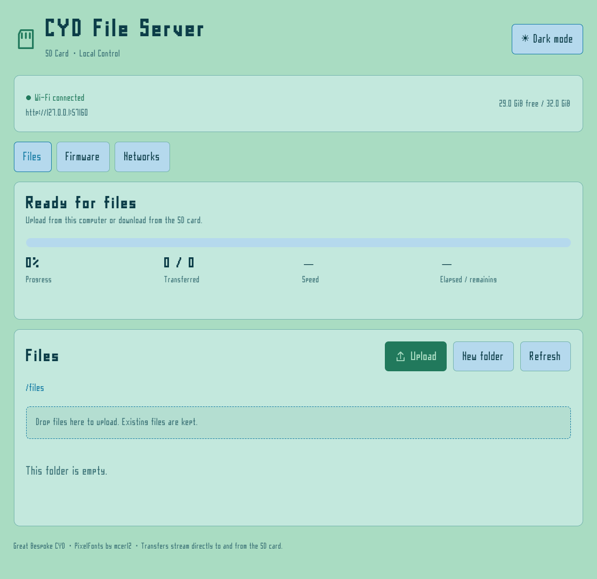

Transfers stream through bounded buffers rather than loading whole files into
RAM. Download progress measures bytes sent by the CYD; the browser/OS can finish
saving afterwards. Actual throughput depends on SD, Wi-Fi signal, access point,
client and concurrent work; this repository makes no universal speed claim.

Only `/files` and `/firmware` are shared; private configuration/key directories
are outside the served tree. Authenticated clients **can manage firmware files**,
so treat access as trusted. Path policy rejects decoded traversal, NUL and
invalid UTF-8. HTTP is not encrypted: use a trusted LAN, not Internet port
forwarding. Enterprise EAP and captive-portal sign-in are not implemented.
The full new-LAN phone walkthrough remains pending; browser tests exercise the
UI with mocks, not real association. See [configuration](docs/configuration.md).

## 3. Terminal Micro: readable remote shells

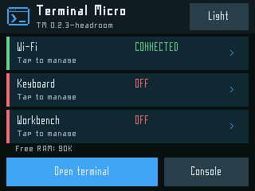
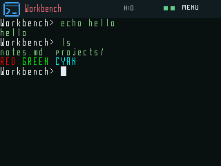

Terminal Micro opens an SSH shell; remote software executes on the server.
An optional remote TUI such as `openclaw tui` can be typed at the prompt if that
host already provides it. No AI runtime or remote application is embedded in
this firmware, and nothing is automatically launched.

1. Privately provision Wi-Fi, host profiles, a dedicated RSA PEM key and a
   verified server host fingerprint using [this guide](docs/configuration.md).
2. Tap **Keyboard**. Wake a saved B1, or **Scan B1 → Pair** in pairing mode.
   Type any displayed passkey on the keyboard followed by Enter.
3. Select a configured host and **Open terminal**. Disconnect before switching.
4. Tap the terminal header for **Font − / +**, **Live output**, **Disconnect**,
   **Resume** and **Console**.

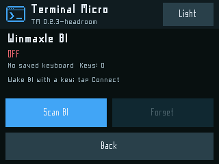
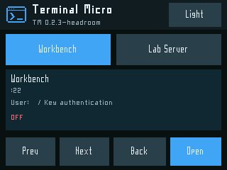

| Font | PixelFonts face | PTY grid |
|---|---|---|
| Small | 7x5 thin | 53 columns × 21 rows |
| Default | 11x5 thin | 40 columns × 15 rows |
| Large | 13x7 semibold | 32 columns × 13 rows |

**Ctrl+Plus/Equals / Ctrl+Minus** change size and resize the remote PTY. Swipe
vertically or use **Shift+PageUp/Down** for bounded main-screen history. **Live**
returns to current output; alternate-screen programs manage their own history.
The connected host appears in the terminal header. The tested keyboard is a
Winmaxle B1; support for every BLE keyboard is not claimed.

Unknown/changed server identity blocks before authentication. The accepted
client requires **ECDSA nistp256 host keys**, uses dedicated RSA client keys,
AES-CTR and supported SHA-256 MACs. Keep this distinction when collecting the
fingerprint. This is a bounded ANSI implementation, not full xterm/Unicode.
Wi-Fi + BLE + SSH has little spare RAM: retain the configured buffer limits.

Historical SD key-directory and JSON theme tokens remain for accepted-binary
compatibility; [the configuration guide](docs/configuration.md) explains them.
The legacy app is not required or distributed. Never commit your edited profile
or private key. A FAT32 card cannot enforce confidentiality; revoke the dedicated
server key if the card/device is lost.

## Install the release

For Usage, use the separate [0.2.0 early-access download](https://github.com/staffordlumsden/great-bespoke-cyd/releases/tag/usage-v0.2.0) and its [SD setup guide](projects/usage/README.md).

For the accepted Console/File Server/Terminal Micro bundle, download the latest `great-bespoke-cyd-*.zip` from [Releases](https://github.com/staffordlumsden/great-bespoke-cyd/releases/latest).
Extract it, enter its `distribution` folder, and verify `SHA256SUMS.txt` with
`shasum -a 256 -c SHA256SUMS.txt` (Linux: `sha256sum -c`).

**Existing Console:** copy `distribution/sd/` contents to SD, preserving other
files, then install File Server and Terminal Micro through Console.

**First install or a different layout:** read [the complete installation and
backup procedure](docs/install.md). You need a matching bootloader, partition
table, initial OTA selector and factory Console. Never flash an app-only image
to factory at `0x10000`. No erase-all operation is part of routine installation.

Accepted prebuilt app sizes are 921,888 and 1,376,832 bytes. The Usage candidate is 1,050,400 bytes. Console is 336,000 bytes.
Both app slots are 1,769,472 bytes; factory is 524,288 bytes. Image hashes detect
corruption, **not publisher authenticity**; packages are not signed firmware.
Only install firmware from sources you trust.

## Supported hardware

Tested original ESP32-D0WD-V3 rev3.1, 4 MB, dual-USB ESP32-2432S028R,
320×240 resistive touchscreen and FAT32 SD. No PSRAM assumption.

Display uses the tested ST7789-compatible API profile: BGR, axes swapped,
both mirror bits set, inversion off. Exact LCD controller and board revision
are not confirmed by ID reads. CYD clones may require different drivers/pins;
check [the hardware reference](spec/reference.md) before writing firmware.
The small inactive glass margin is not a drawing offset to compensate for.

## Build from source

Python 3.10–3.13, Git, a C/C++ build environment and several GB of storage are
needed. Commands run from the checkout root. The SDK and tools live under
ignored `.tools/`; no global ESP-IDF install is assumed.

```sh
git clone https://github.com/staffordlumsden/great-bespoke-cyd.git
cd great-bespoke-cyd
bash tools/setup-idf.sh
bash projects/launcher/firmware/tools/build.sh build
bash projects/file-server/firmware/tools/build.sh build
bash projects/terminal-micro/firmware/tools/build.sh build
bash projects/usage/firmware/tools/build.sh build
bash tools/test.sh
```

ESP-IDF v5.5.5 is pinned by commit; the bounded BT linker path patch permits
checkout paths containing spaces. The wrapper refuses generic `flash` commands
because generated SDK flash hints would put ordinary apps over factory Console.
Use the documented install process instead. macOS source builds are checked;
CI runs native tests and browser checks on Linux.

Package a new candidate (then add the complete applicable licence notice):

```sh
python3 projects/launcher/tools/package_sd_app.py   --image projects/terminal-micro/firmware/build/TerminalMicro.bin   --output projects/terminal-micro/artifacts/sd-library
```

The packager validates ESP image headers, chip/revision/size, checksum and
appended SHA-256 and refuses conflicting existing output. It produces the
`.bin` and matching `.json`, not hardware acceptance or a licence compilation.
Change `PROJECT_VER` when changing firmware behaviour.

## Create firmware with humans and agents

| Resource | Use |
|---|---|
| [AGENTS.md](AGENTS.md) | Scope, preservation rules, evidence and handoff duties |
| [SKILL.md](SKILL.md) | Portable agent workflow and resource routing |
| [SPEC.md](spec/SPEC.md) | Architecture, product contracts and release gates |
| [reference.md](spec/reference.md) | Pins, layout, toolchain and commands |
| [design.md](spec/design.md) | PixelFonts, palettes and touch behaviour |
| [templates.md](spec/templates.md) | Change brief, app README, release and handoff templates |
| [Minimal example](spec/examples/minimal-app.cpp) | Buildable theme/clock/HAL/Console-return scaffold |
| [status](docs/status.md) / [resume](docs/resume.md) | Current evidence, limitations and next steps |

```sh
python3 tools/new_app.py --project HelloCYD --output projects/hello-cyd
bash projects/hello-cyd/firmware/tools/build.sh build
```

The human defines the useful outcome and authorizes device/external actions.
The agent checks the contracts, builds and tests, explains limits and offers
short on-device checks. The human judges readability and behaviour on the real
screen. Record those observations separately from mock/native test results and
leave a dated checkpoint for the next contributor. Skills do not grant device
write or publication permission. The generator refuses to overwrite a project.

## Test, screenshots and website

`bash tools/test.sh` runs native ASan/UBSan tests for loader integrity/faults,
clock conversion, path policy, drawing/hit bounds, touch filtering, fonts,
terminal DMA strips, ANSI colours and stale-row clearing, then public-file
validation. Browser tests use Playwright with local fixture APIs. See
`tools/test-site.cjs` and `projects/file-server/tests/browser_ui.cjs`.

```sh
npm ci
npx playwright install chromium
node projects/file-server/tests/browser_ui.cjs
python3 tools/screenshots.py   # requires Pillow; after native/browser tests
node tools/test-site.cjs
```

The self-contained site is `site/`, deployed through GitHub Pages Actions.
No analytics, remote fonts or runtime framework. Theme is stored locally.
`validation.json` records the first publication checks; CI adds ongoing evidence.

## Licences and provenance

Original project work: [MIT](LICENSE). PixelFonts by
[mcer12](https://github.com/mcer12/PixelFonts), MIT. ESP-IDF and libssh2 retain
upstream terms. Read [THIRD_PARTY.md](THIRD_PARTY.md), retained component licences
and binary package notices. This project makes no M5Stack affiliation claim.
