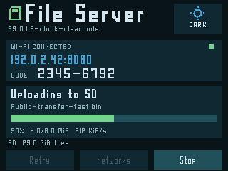

# File Server

Accepted prebuilt release: **0.1.2-clock**. Rebuilt sources require new physical
acceptance. Screenshots are actual firmware-renderer/browser captures with
public fixture data, not photographs or live private sessions.

A browser interface to SD files on a trusted LAN: uploads/downloads, directory
navigation, visible progress and cancel. The CYD displays address, port and a
readable numeric access code. Both device and browser offer dark/mint themes.




Open the displayed address in a browser on the same network and enter the code.
Use Files to transfer; Networks to provision another 2.4 GHz LAN. Browser download
progress reports bytes sent by the CYD; browser/OS save completion can follow.
Setup hotspot supports a new network; complete fresh-LAN phone testing is pending.
HTTP is unencrypted; use trusted local networks. No enterprise EAP/captive portal.
Only `/files` and `/firmware` are shared; private configuration and keys are excluded.

## Build and test

From repository root:

```sh
bash tools/setup-idf.sh
bash projects/file-server/firmware/tools/build.sh build
bash tools/test.sh
```

Read [installation](../../docs/install.md), [private configuration](../../docs/configuration.md),
[release status](../../docs/status.md) and [third-party rights](../../THIRD_PARTY.md).
Source builds use the shared table, HAL, clock and fonts. App images are packaged
with `projects/launcher/tools/package_sd_app.py`; attach full notices. Console
is updated over USB at factory only after layout/backup verification.
