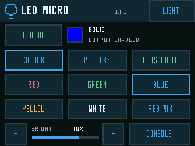
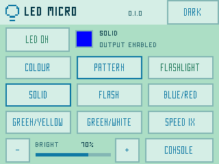
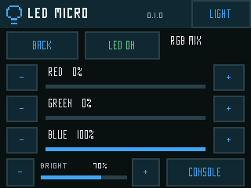

# LED Micro

Offline RGB LED control for the Great Bespoke CYD. Version **0.1.0**.
PixelFonts, dark and mint/blue light themes, 34–36 px touch targets, and safe
return to the resident Console. No network, account, keyboard or secrets file.

**Status: user-accepted on the tested CYD, 16 October 2026.** The user
confirmed SD installation, red/green/blue/white selection, brightness, on/off,
flashing, all three alternating patterns, speed and white flashlight. Console
turns the LED off, and Run last reopens the app with the LED off. Pinned build,
native sanitizer/PWM-driver tests and package integrity also pass. Saved
preferences, RGB-mixer adjustments and theme changes were not separately
reported in this physical check; no electrical/timing measurements were taken.
The distributed package is the accepted image, byte-verified on the development
card. No USB flash was required. See the release below for the three SD files.

[Download LED Micro 0.1.0](https://github.com/staffordlumsden/great-bespoke-cyd/releases/tag/led-micro-v0.1.0)

## Install

Copy all three files from `artifacts/sd-library/` into the SD card's `/firmware`:

- `LEDMicro-0.1.0.bin`
- `LEDMicro-0.1.0.json`
- `LEDMicro-0.1.0-LICENSE.txt`

Preserve existing files, NVS/bonds, factory Console and the clock-capable File
Server slot. Eject the card, return it to the powered-off CYD, then use Console
→ Load from SD Card → LEDMicro-0.1.0 → Install + run. Do not use IDF's generic
factory flash command: apps belong in Console-managed OTA slots. The convenience
archive is `artifacts/LEDMicro-0.1.0-sd.zip`; it contains no private configuration.

## Controls

| Control | Behaviour |
|---|---|
| LED OFF / LED ON | Shows current power state; tap to toggle. Every launch starts OFF. |
| COLOUR | Red, green, blue, yellow or white preset. Selecting a colour chooses solid mode and retains the current power/brightness. |
| RGB MIX | Adjust red/green/blue independently in 10% steps, then BACK. Power and global brightness remain available. |
| PATTERN | Solid; flashing the selected colour; blue/red; green/yellow; green/white. Pattern selection retains power state. |
| SPEED | Cycle .5X, 1X and 2X: respectively 1000, 500 and 250 ms per phase (0.5, 1 or 2 complete cycles/sec). |
| FLASHLIGHT | One tap enables solid white, all three LED channels, at 100% brightness. The screen remains the normal control panel. |
| Bottom − / + | Global brightness in 10% steps, 0–100%. Zero is dark even while power is enabled. |
| LIGHT / DARK | Change the whole app theme. |
| CONSOLE | Turn the LED off, detach PWM and return to the verified factory launcher. |

Controls act once on release. A dragged touch is cancelled; holding a button
does not repeatedly change settings. A startup touch must be released before
controls activate. The preview swatch follows the current pattern phase.
The screen remains awake while using the app; there is no automatic screen
sleep that would obscure the controls or silently alter LED output.

Theme, colour, mode, speed and brightness are saved after a short quiet period
in the app-owned `led_ui` NVS namespace. LED power is deliberately never saved:
relaunch/cold boot starts OFF. Existing keyboard, network and clock settings
are untouched. An initialization failure never triggers NVS erasure. This app
needs no SD files at runtime, so SD mount failure alone does not prevent its
first-boot acknowledgement; healthy display, touch, PWM, NVS and a valid Console
are required. PWM failure disables output and leaves theme/Console navigation.

## Hardware and timing

The RGB reference profile is red GPIO4, green GPIO16, blue GPIO17, **active low**.
This is documented in the primary [CYD pin reference](https://github.com/witnessmenow/ESP32-Cheap-Yellow-Display/blob/main/PINS.md#rgb-led);
the user confirmed the corresponding colour selections on this board.
That is functional confirmation, not an independent pin-voltage measurement.
No display/touch/SD pins are repurposed and no shared HAL changes were made.
The exact LCD silicon/PCB revision remains unverified; keep the accepted display
profile rather than importing a different board's display initialization.

ESP-IDF LEDC low-speed timer0/channels0–2 generate inverted 4 kHz, 12-bit PWM.
Duty zero therefore drives HIGH/off; logical brightness scales each channel
linearly, rounded and clamped to 0–4095. Phase selection uses monotonic elapsed
time in a 10 ms polling loop, not blocking flash delays. Only the preview region
is repainted for phase changes; LED output and touch processing continue.
Shutdown stops PWM, disconnects it and drives all three GPIOs HIGH. Core logic
is separate from the ESP driver adapter so polarity, limits, timing and failures
can be tested without hardware.

## Build, tests and evidence

From the project root:

```sh
bash projects/led-micro/tests/run-native.sh
bash projects/led-micro/firmware/tools/build.sh build
python3 projects/launcher/tools/package_sd_app.py \
  --image projects/led-micro/firmware/build/LEDMicro.bin \
  --output projects/led-micro/artifacts/sd-library
```

Pinned ESP-IDF v5.5.5 / `b774170ff46c393eeb5e495ea37936038d3f4f4f`;
original ESP32, 4 MB layout, no PSRAM. No radio is initialized. The wrapper
rejects generic flash/app-flash and checks the SDK pin. Native ASan/UBSan tests
cover phases, speed, output-off/zero, range clamping, RGB adjustment, flashlight,
touch hold/release/drag, every button's bounds/non-overlap and both themes.
Driver fakes exercise actual `led_output.cpp`, inverted channel routing and
injected timer/channel/update errors. They do not prove physical polarity.

Image: **306,240 bytes**. SHA-256:
`41af56faff22d0ad2625f06fa82a0abfb3c5b71345a276544dd405a7efb05512`.
Image checksum/appended hash, descriptor and OTA slot fit are validated by the
packager and esptool. Applicable notices: [THIRD_PARTY_NOTICES.md](THIRD_PARTY_NOTICES.md).

Ignored evidence: `artifacts/build.log`, `native-results.log`, `image-info.txt`,
`validation.json`, `SHA256SUMS.txt`, `native/*.png` and `native/review.png`.
The requested installation, colour/brightness/pattern/flashlight/Console checks
are user-accepted. No new settings or secret file is needed.

## Screenshots

Actual firmware-renderer captures; no private data or hardware photographs.




