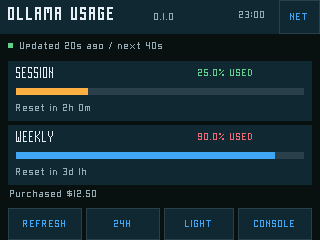
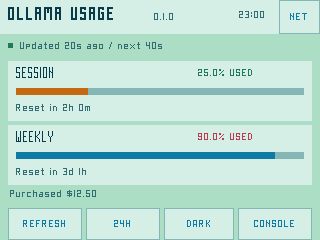
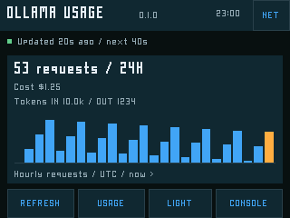
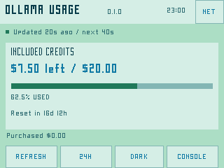

# Ollama Cloud Usage

**Your cloud allowance, on a dedicated little screen.** An SD-installable CYD
app with touch controls, shared PixelFonts and dark/mint-blue themes.

[Download 0.1.0 early access](https://github.com/staffordlumsden/great-bespoke-cyd/releases/tag/ollama-usage-v0.1.0) ·
[Project website](https://staffordlumsden.github.io/great-bespoke-cyd/#ollama)




**Release status:** ESP32 build, automated tests and live API/parser checks pass.
Physical CYD installation, TLS/memory, touch and sleep acceptance remain pending.
Pictures are actual renderer captures with public examples, not live account data
or hardware photographs. The private key is never included in a download.

## What it shows

- Legacy accounts: session and weekly **percentage used** (`100 - remaining`)
  and reset countdowns. Orange session and blue weekly bars follow the supplied
  browser-extension reference; percentage labels independently warn at 75/90%.
- Credit-based accounts: remaining included USD, allowance, used percentage,
  period reset and a separate purchased-credit balance.
- **24H**: total requests and up to 25 UTC hourly bars, including the current
  partial hour. Bars count requests. Cost and input/output token totals appear
  only if the API supplies them; unavailable values are labelled honestly.
- Update age, connection/error feedback and STALE markers after failures or
  old data. Clock and reset durations use the shared platform clock.




No inference requests are made, no browser cookies are needed, and there are no
invented plan names or per-model estimates. A keyboard is not required.

## Install on an existing Console

1. Download `OllamaUsage-0.1.0-sd.zip` from the early-access release. Verify its
   checksum against the release's `SHA256SUMS.txt` before extracting.
2. Copy the archive's `firmware/` contents to your FAT32 card's `/firmware`.
   Keep the `.bin`, matching `.json` manifest and `-LICENSE.txt` together.
   Preserve other files. Existing File Server users can upload these three
   firmware files through its browser interface.
3. Using an **SD reader**, create `/private/ollama.json` with your dedicated
   Ollama API key. Start with [the blank example](ollama.example.json), replace
   its placeholders and keep the edited file out of Git. Do not put it in a
   browser-served directory. File Server does **not** expose `/private`.
4. Return the card, boot Console and tap **Load from SD Card →
   OllamaUsage-0.1.0 → Install + run**. Keep the clock-capable File Server in
   its retained slot; this app uses the ordinary app slot.

For a first Console installation, use [the platform installation guide](../../docs/install.md).
Do not flash this application image over factory Console. The SDK's generic
flash hints target factory; the project's wrapper deliberately rejects them.

### Private configuration and Wi-Fi

The file accepts `api_key` and an optional `wifi` list of up to four distinct
2.4 GHz WPA2/WPA3-Personal profiles (`ssid`, `password`, optional `priority`).
Delete the example's `wifi` member to reuse saved SD profiles. Without explicit
profiles the app reads File Server's newest valid network file, then fills
available slots from Terminal Micro or the legacy compatible SD configuration.
Existing files are read-only and never rewritten. No open/enterprise Wi-Fi,
captive-portal login or 5 GHz-only support is implemented.

For another LAN, provision it through **File Server → Networks**, then relaunch
Ollama Usage. A changed Wi-Fi configuration requires relaunching. **NET →
RELOAD KEY** rereads only the API key, clears previously displayed account data
and respects the current retry cooldown. The key stays in SD/RAM, never NVS or
the firmware image. FAT32 is not encrypted; protect the card and revoke a lost
key. Console's radio tiles do not provision networks.

## Touch controls

| Control | Action |
|---|---|
| REFRESH | Refresh when eligible; minimum interval/backoff still applies. |
| 24H / USAGE | Switch activity and allowances; return from NET. |
| LIGHT / DARK | Change theme; save only in app-owned `ou_ui` NVS. |
| NET | Open/close connection and API-key information. |
| RETRY / NEXT | Retry Wi-Fi or use the next profile. Disabled during HTTPS work. |
| RELOAD KEY | Reread the private file when idle; preserve active Wi-Fi profiles. |
| CONSOLE | Return to verified factory Console, including during a fetch. |

After five idle minutes, the display/backlight sleeps and new polls pause.
Touch and release wakes it without triggering a button. Wi-Fi stays running;
in-flight work can complete. This is display sleep, not deep sleep or USB
power-off. Original 32 px bottom controls still need physical touch acceptance.

## API, polling and evidence

The official bearer-authenticated GETs are fixed to:

- `https://ollama.com/api/balance`
- `https://ollama.com/api/usage?range=24h&scope=self`

HTTPS uses CA certificate and hostname validation, with redirects disabled.
A valid clock is required; SNTP starts when appropriate. No insecure fallback
or configurable server endpoint exists. Healthy cycles wait 60 seconds after
completion; errors back off through 60/120/240/480/600 seconds and honour a longer
numeric Retry-After. 401/403 halt automatic retries until Refresh or Reload Key;
those actions still respect cooldowns. Response bodies are bounded to 24 KiB,
validated and wiped; HTTP runs separately from touch/rendering. No account
payload or credential is logged or persisted. Last good data remains visibly
STALE after failures, a lost connection or two minutes without updates.

Both live official endpoints returned HTTP 200 on the development host and
passed the actual firmware parser. The checked account supplied legacy limits
and request counts; credit-based and optional-metric views are fixture-tested.
Host checks do not establish ESP32 TLS, memory or physical acceptance.

The shipped app is **1,032,400 bytes**, within the 1,769,472-byte slot. Its SHA-256:

```text
881ab28385f34b1b0b586af4f9463db708759043c953e4678fd8d324514fafe8
```

It preserves the prepared SD candidate byte-for-byte. Public-layout source
rebuilds are candidates, not a claim of bit-identical images or hardware acceptance.

## Build and test

From a checkout with the [pinned SDK set up](../../README.md#build-from-source):

```sh
bash projects/ollama-cloud-usage/tests/run-native.sh
bash projects/ollama-cloud-usage/firmware/tools/build.sh build
```

Native ASan/UBSan tests cover the actual model, config/filesystem fallback,
poll/retry policy, UI geometry and actual HTTP code with deterministic ESP API
fakes. The pinned SDK's cJSON is vendored **for native tests only** so CI does
not need the full SDK. ESP firmware still uses the SDK JSON component. Shared
Wi-Fi comes from `common/terminal-core`; no excluded application's source is
required. Preview PPMs live in ignored `artifacts/native/`.

An optional local API check makes no inference calls:

```sh
python3 projects/ollama-cloud-usage/tools/check_api.py --config /PRIVATE/PATH/ollama.json
```

This sends the key only to Ollama, feeds response bodies to the native parser
through stdin, and prints status/validation flags only. It is not a CI step.

See [release evidence](../../docs/status.md), [the shared specification](../../spec/SPEC.md),
[upstream OpenAPI](https://github.com/ollama/ollama/blob/main/docs/openapi.yaml)
and [full dependency notices](THIRD_PARTY_NOTICES.md).
