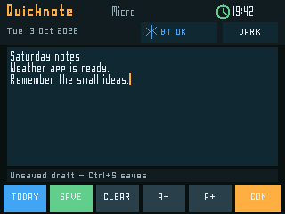
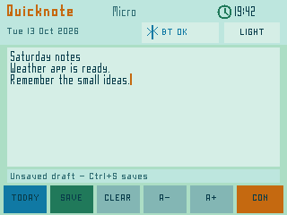
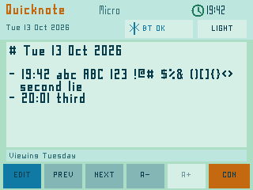

# Quicknote Micro

Current version: `0.1.0`

Quicknote Micro is a native, SD-installable note-taking firmware for the Great
Bespoke CYD. It preserves the original Quicknote workflow: notes are appended
as timestamped Markdown entries to one file per day.

The firmware uses the Console PixelFonts, the tested CYD display/touch/SD
profile, the saved Winmaxle B1 Bluetooth bond and the shared Console clock.
Notes are stored under `/files/QuickNote/Daily/YYYY-MM-DD.md`, so the File
Server app can upload and download them without exposing private configuration.

Quicknote is a separate app with Console PixelFonts; no terminal UI or SSH session is needed.

## Features

- Multiline editing with the B1 keyboard, cursor movement and correction.
- `Ctrl+S` and a touch **Save** button.
- `Ctrl+Plus`/`Ctrl+Minus` and touch **A+**/**A-** text sizing.
- Recoverable hidden draft checkpoints on the SD card.
- Today and previous/next day viewing without loading an unbounded file.
- Small, default and large Console PixelFont choices.
- Dark and mint/blue light themes.
- Return to the resident Console without changing the saved keyboard bond.
- Save blocking when the shared clock is unset, with a clear route back to
  Console for automatic or manual time setup.

## Build from the checkout root

```sh
bash projects/quicknote-micro/tests/run-native.sh
bash projects/quicknote-micro/firmware/tools/build.sh build
python3 projects/launcher/tools/package_sd_app.py \
  --image projects/quicknote-micro/firmware/build/QuicknoteMicro.bin \
  --output projects/quicknote-micro/artifacts/sd-library
```

Install the resulting application-only `.bin` from Console's SD Apps screen.
The resident Console remains in the factory partition.

## Controls and storage

The default 11×5 thin PixelFont is one step smaller than the Console heading
face. The smaller 7×5 thin and larger 13×7 semibold choices are stored in NVS.
Light mode uses mint and blue surfaces; dark mode uses the same flat Console
language. Console PixelFonts are used throughout.

Quicknote checkpoints unsaved text to `/files/QuickNote/.draft` after editing
pauses and before returning to Console. **Save** appends the entry to
`/files/QuickNote/Daily/YYYY-MM-DD.md`, flushes it to the card, retires the
draft, then clears the editor. A save failure retains the text and reports the
storage error. Daily history reads only a bounded tail of the file.

**Today** opens dated history; **Prev** and **Next** change days. Tap the upper
or lower half of the note area, use arrow keys, or use Ctrl+PageUp/PageDown to
move through history. **Con** checkpoints the current draft and returns to the
resident Console.

## Validation status

- ESP-IDF 5.5.5 production build: 807,408 bytes in a 1,769,472-byte slot.
- Package inspection: original ESP32, rev 3.1-compatible app-only image,
  valid image checksum and appended SHA-256.
- Native sanitizer tests: editor bounds and navigation, B1 punctuation and
  controls, repeated FAT32-style draft replacement and recovery, durable
  Markdown formatting, bounded history and all font/theme layouts.
- Existing B1 HID mapping and descriptor suites pass unchanged.
- The final image, JSON sidecar and PixelFonts licence were uploaded through
  File Server and SHA-256 verified after reading them back from the SD card.

User acceptance on 13 October 2026: “quicknote micro acceptance test complete
and no issues found”. Version 0.1.0 is accepted. This is a broad user report;
separate instrumented full-card/removal fault tests and a cold-start failure
matrix are not established by that statement. See [status](../../docs/status.md). Native
tests and SD readback are recorded separately from the physical report.

## Install

[Download Quicknote Micro 0.1.0](https://github.com/staffordlumsden/great-bespoke-cyd/releases/tag/quicknote-v0.1.0).
Copy `QuicknoteMicro-0.1.0.bin`, `.json` and `-LICENSE.txt` from the release ZIP
(or `distribution/sd/firmware/`) into SD `/firmware`. Preserve other packages,
notes, keys, keyboard bonds and the clock-capable File Server slot. Choose
Console → Load from SD Card → QuicknoteMicro-0.1.0 → Install + run.
Set the Console clock first; wake the saved B1 or use Quicknote's pairing
controls. The B1 is the tested keyboard; arbitrary BLE keyboards are unverified.

The accepted image SHA-256 is
`295b035e124681daa4c4435c0cdc056e55e590f1a6121a7876a8f680fab446a0`.
It is preserved byte-for-byte; public source relocates shared keyboard code to
`common/terminal-core` and makes tests/builds portable. A source rebuild is a
candidate, not a new hardware acceptance. Full [font/SDK notices](THIRD_PARTY_NOTICES.md)
accompany the package. Notes and hidden drafts are plaintext on FAT32, not
encrypted. File Server can transfer saved daily Markdown files on your LAN.

## Screenshots

Actual firmware-renderer captures from public sample notes, not private notes
or hardware photographs.




