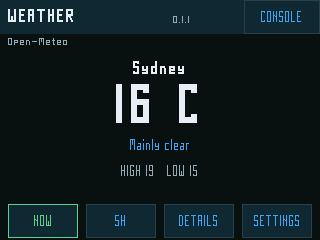
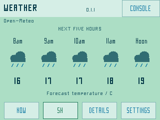
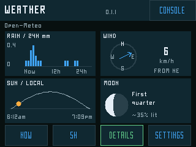
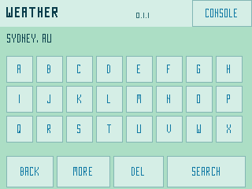

# Weather Micro

Open-Meteo forecasts for the original-ESP32 Great Bespoke CYD. **0.1.1-stack**.
Four main screens, large touch controls, the pinned PixelFonts, dark and
mint/blue themes. No API key or keyboard is required. Up to six saved places.

**Status: user-accepted for the basic weather workflow on 17 October 2026.**
The user confirmed the repaired app after the location-search/NOW/5H check.
On-device UART separately establishes a rendered first frame, successful OTA
confirmation, real HTTPS search (HTTP 200) and main/worker minimum stack margins
of 5,064/4,444 bytes in the bounded capture. Multiple saved places, individual
chart accuracy, physical theme/unit persistence, Console/Run last and extended
network failure tests were not separately reported.

[Download Weather Micro 0.1.1-stack](https://github.com/staffordlumsden/great-bespoke-cyd/releases/tag/weather-v0.1.1-stack)

Version 0.1.0 was an unpublished development package with a renderer stack
overflow. It is excluded from the release. If you received that package during
development, replace it with 0.1.1-stack; see [recovery](../../docs/install.md).

## Install and choose a place

Back up and remove the known-bad 0.1.0 package from SD `/firmware`.
Download the release ZIP or copy its three files from
`distribution/sd/firmware/` into SD `/firmware`:
`WeatherMicro-0.1.1-stack.bin`, `.json` and `-LICENSE.txt`. Preserve existing files,
NVS/bonds, resident factory Console and the clock-capable File Server slot.
Use **Console → Load from SD Card → WeatherMicro-0.1.1-stack → Install + run**.
The release archive `WeatherMicro-0.1.1-stack-sd.zip` contains matching files and
instructions. Source builds can be packaged separately under `artifacts/`. Do not follow IDF's generic factory-flash hint for this app.

1. Wait for saved Wi-Fi to connect and valid time for HTTPS.
2. **SETTINGS → SEARCH + SAVE**. Type a town/city, optionally `, country` or
   region. The large letter keys cover A–X; **MORE** has Y/Z, digits, punctuation
   and **SP** (space). **DEL** removes a character; queries are 2–40 characters.
3. Tap **SEARCH**, then the result with the correct region and country. Results
   paginate three per page; the selected result is saved and becomes active.
4. **PLACES → place → USE LOCATION** switches saved forecasts. **REMOVE** deletes
   only that saved place. At the six-place limit remove one before saving another.

No user location is guessed, tracked by GPS or selected from an IP address.
Place names are requested in English; common accented Latin letters are mapped
to ASCII for the current font atlas, other unsupported characters use `?`.
Weather values are cached by place ID: delayed downloads cannot be relabelled
as another place, and replies for removed places are discarded.

## Screens

| Tab | Content |
|---|---|
| NOW | Centred place, large temperature, condition description of at most three words, today's forecast high and low. Tap NOW again for a rate-limited refresh. |
| 5H | The next five complete hourly timestamps, in exactly three main rows: time, original vector weather icon, forecast temperature. Noon and am/pm labels use the selected place's local offset. |
| DETAILS | Four panels: 24-hour rain bar graph in mm; wind compass/speed; sunrise/sunset horizon/arc; monthly moon-phase diagram and approximate illumination. |
| SETTINGS | C/F, theme, saved places, touch search, network retry/next and source attribution. |

The top **CONSOLE** button remains available in every page, including during
an HTTP request. Touch acts once on release and a dragged press cancels.
The screen stays awake; unchanged menus are not continually redrawn.

C/F conversion is immediate for current, daily and hourly temperatures; rain
remains **mm** and wind **km/h**. Unit, theme, saved places and selection persist
only in app-owned NVS `wx_ui`; Wi-Fi keys are not stored there. Initialization
errors never erase NVS. SD health is part of the first-boot gate because saved
network profiles are needed. No BLE radio or assumed PSRAM is used.

## What the diagrams mean

- Current conditions are Open-Meteo weather-model values, not a promise of
  readings from a nearby physical weather station. WMO codes select descriptions
  and independent vector icons, including night, fog, snow and thunderstorms.
- The hourly value is Open-Meteo `temperature_2m` **at the labelled hour**.
  It is not an invented maximum within that hour. Daily high/low use the daily
  max/min fields for the selected place's date.
- Rain bars sum `rain + showers`, excluding snow. Each timestamp is an
  interval-ending preceding-hour total. The next 24 entries are shown; the first
  may include the elapsed part of the current hour. The vertical scale adapts
  to the peak amount. Missing bars have small grey crosses, not invented zeroes;
  entirely missing data says so. A genuinely dry forecast has a zero scale.
- Compass bearing is the meteorological direction wind comes **from**. A calm
  wind has no directional arrow. Missing speed/direction stays unavailable.
- The sun arc is a schematic progress line between that day's sunrise and
  sunset, with the horizontal line as the horizon. It is not an accurate solar
  altitude/azimuth plot. At night or for polar/missing events it does not invent
  a daytime sun position.
- Daily `moon_phase` comes from Open-Meteo, not a fabricated clock cycle.
  Approximate illuminated percentage and the terminator diagram are derived
  from that fraction; the image mirrors for southern latitudes. It is not the
  exact sky orientation, libration or rise/set prediction. Missing phase says so.
- Local labels use the response's `utc_offset_seconds` without altering the
  shared system timezone. Open-Meteo fixes that offset at request time; forecast
  labels crossing a daylight-saving transition may differ by an hour until
  refreshed after the transition. This app does not bundle an IANA timezone
  transition database. Half/quarter-hour offsets are supported.

## Network and freshness

Wi-Fi profiles are read without rewriting files: newest valid File Server
`net-a.json`/`net-b.json`, then compatible Terminal/legacy profiles, deduplicated
and bounded to four networks. **NETWORK → RETRY / NEXT NETWORK** rejoins or
cycles those profiles. Provision a new LAN using File Server's network setup,
then relaunch Weather. Console's radio tiles are placeholders. The CYD supports
2.4 GHz personal networks; there is no enterprise/captive-portal browser.

Fixed HTTPS origins: `api.open-meteo.com` and `geocoding-api.open-meteo.com`.
ESP-IDF's CA bundle and hostname verification stay enabled. No redirects or
insecure time/TLS fallback. Shared clock/SNTP supplies valid time first.
A separate bounded worker keeps downloads off the touch task. A response is
limited to 24 KiB, JSON nesting/duplicates/NUL and units/types/array alignment
are checked before replacing snapshots. Individual missing values stay unknown.

Only the selected place polls, normally every 15 minutes. Failures back off
60/120/240/480/900 seconds; numeric Retry-After is respected, including manual
refresh. Manual requests have a 30-second minimum; search has its own cooldown.
Old or failed/offline data is marked STALE rather than silently looking fresh.
Forecasts are in-memory caches and do not survive a reboot; saved places do.
No query/location/SSID/password or raw HTTP payload is logged. Examples and
fixture captures use public Sydney API data, not a private user's saved places.

Sources and attribution: [Open-Meteo forecast](https://open-meteo.com/en/docs),
[geocoding](https://open-meteo.com/en/docs/geocoding-api),
[CC BY 4.0 data licence](https://open-meteo.com/en/licence),
[GeoNames](https://www.geonames.org/about.html). Public personal/non-commercial
endpoints are used; see the provider's current service terms for other use.
Settings → ABOUT credits Open-Meteo and GeoNames on device.
[Full notices](THIRD_PARTY_NOTICES.md) include PixelFonts, SDK, Mbed TLS and cJSON.

## Build and evidence

```sh
bash projects/weather-micro/tests/run-native.sh
bash projects/weather-micro/firmware/tools/build.sh build
python3 projects/launcher/tools/package_sd_app.py \
  --image projects/weather-micro/firmware/build/WeatherMicro.bin \
  --output projects/weather-micro/artifacts/sd-library
```

Pinned ESP-IDF v5.5.5, original ESP32, 4 MB, rollback and no PSRAM. The public
build references `common/terminal-core` for shared Wi-Fi, not a duplicate
radio stack. Native ASan/UBSan tests cover live-response fixtures, malformed/
null/duplicate/oversize/unit/array cases, C/F, Noon/midnight/half-hour labels,
settings, owner-ID caches, sun/moon/wind helpers and all hit targets/pages in
both palettes. Actual HTTP code is compiled against fakes for TLS config,
origins, no auth/redirects, chunking and transport/HTTP/size/parse failures.
Read-only network-profile fallback/precedence/credentials are separately tested.
Fakes do not prove MCU task-stack/heap, TLS or physical touch usability. The
ESP32 build uses `-Wframe-larger-than=2048 -Werror=frame-larger-than=2048`
and `.su` reports. Largest application-component frame is 1,408 bytes; individual
frame limits do not bound a full call chain. Runtime minimum stack bytes are
logged at render and HTTP completion. First boot confirms health after drawing.

Image: **1,100,288 bytes**, SHA-256
`ed9cb897148ccf9bed52b3712ce52b88c93ee9dfa2d2942863cdfc2dbf67c06e`.
Packager/esptool descriptor, checksum/appended hash and slot fit pass. Image,
manifest, full notices and ZIP entries are byte-verified.

The prebuilt image is the accepted development binary, unchanged. Public source
relocates shared Wi-Fi dependencies and makes the build wrapper portable; a
source rebuild is a candidate until tested on hardware. See
[validation and acceptance limits](../../docs/status.md).

## Screenshots

Captures from the actual firmware renderer with public Open-Meteo fixture data;
not private locations, live forecasts or hardware photographs.





